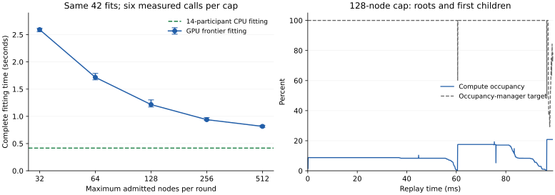

The current frontier fitter has a material admission/batch-scheduling bottleneck. On identical prepared samples, increasing the maximum admitted nodes per round from 128 to 512 reduces complete-fitting median time from **1.216 s to 0.815 s (32.95%)**, with unchanged kernel arithmetic and exact trees. The larger batches also expose more launch backpressure and occupancy-management activity. The evidence supports distributing work more effectively while controlling its storage footprint; it does not establish one fixed register or threadgroup-memory limit as the cause of all low occupancy.

This study used `feat/gpu-resident-fitting` at `4d799089`, plus the private diagnostic changes, on the **M4 Pro, 20 GPU cores, 48 GiB, AC power**. It replays the archived first cohort from photograph **1029: 42 fits, 5,285,712 prepared rows, and 35,878 resulting tree nodes**. Times below cover complete fitting of that cohort, not an image encode or a sum across photographs. The prior [attribution study](gpu-frontier-attribution.md) used battery power; its timings are kept separate. [Structured results](gpu-frontier-occupancy-results.json) and [raw artifacts](../build/frontier-occupancy-20261017/) preserve the measurements and provenance.

The timing boundary includes validation, scratch management, GPU input upload, GPU node setup/selection/partition/queue management, canonicalization, and final publication. It excludes sample preparation, CPU input restoration, backend/domain/worker-pool creation, and equality checks. The CPU control fits the same archived samples with 14 participants. It is a fitter comparison; it does not compare two complete encoder configurations.

| Maximum admitted nodes | Complete-fitting median | Observed range | Command-buffer GPU-span median | Scratch | Peak managed backing |
|---|---:|---:|---:|---:|---:|
| 32 | 2.593 s | 2.555–2.617 s | 2.555 s | 8.33 MiB | 234.91 MiB |
| 64 | 1.716 s | 1.670–1.789 s | 1.683 s | 16.66 MiB | 243.24 MiB |
| **128, current default** | **1.216 s** | **1.172–1.302 s** | **1.189 s** | **33.31 MiB** | **259.90 MiB** |
| 256 | 0.939 s | 0.924–0.977 s | 0.913 s | 66.63 MiB | 293.21 MiB |
| 512 | 0.815 s | 0.800–0.835 s | 0.787 s | 133.25 MiB | 359.84 MiB |

Each cap has six measured observations: three process blocks, each with one warmup and two measured calls per route. Cap order varies across blocks; the CPU/GPU order alternates within each process. All observations are retained. The three block-median reductions for 512 versus 128 are **32.52%, 35.19%, and 32.51%**. The interleaved CPU-fitting median across 30 observations is **0.416 s**, with a 0.384–0.583 s range. The GPU fitter therefore remains slower on this workload. Background OS activity was recorded; no competing codec benchmark/build was detected, and AC power was checked throughout the matched runs.

All caps use a fixed 256 MiB scratch *ceiling* so the requested admission is not silently clipped. Allocation follows the actual cap: 128 still allocates only 33.31 MiB of scratch. Each slot is 272,896 bytes, dominated by a worst-case 256 × 256 integer histogram. The default operation's scratch ceiling remains 64 MiB, so merely requesting 512 with that ceiling would not admit 512. Peak managed backing excludes the common immutable archive, driver/backend/profiler allocations, and unrelated process memory; it is not RSS. Increasing the cap from 128 to 512 adds **99.94 MiB** of managed backing for this cohort.

The reduction appears principally in the GPU span: approximately 0.403 s, alongside a 0.401 s complete-call reduction. Median wall time minus GPU span stays around 27–28 ms. Rounds fall from 284–285 to 78, and submissions from 18 to 5. This supports admission and GPU batch execution as the target, rather than CPU wait overhead. It does not separately quantify load balancing, GPU dispatch overhead, and cache-locality effects.

Queue and node-size diagnostics make the scheduling limitation concrete. Separate, instrumented runs submitted one round at a time and saved the final GPU queue and node ranges. Reconstructing the rounds from that queue agrees exactly with every logged head, tail, count, and round total:

- At cap 128, **278 of 284 rounds** had more ready nodes than the cap. The uninstrumented runs reached **5,078–5,112 ready nodes**.
- The first round has only 42 roots; the second has 84 children. Raising the admission cap cannot give one of these large nodes more than its existing 128-thread group.
- Within the 128-cap diagnostic, the median ratio of the largest node's row count to its batch's median node row count is **15.39×**. At cap 512 it is **25.89×**. Row count is a work-size proxy, not a measurement of each node's execution time.
- Both diagnostics process exactly **62,032,411 node-row memberships** and publish the same trees. The larger cap changes batching rather than reducing tree work.

These one-round diagnostics perturb submission behavior and perform diagnostic writes. Their complete-call times are not included in the table. Their GPU spans include queue setup, and the first also includes initialization; they are not per-node or per-phase timers.

Fresh AC replay counters also distinguish available work from pressure on resources:

| First captured submission | 128-node cap | 512-node cap |
|---|---:|---:|
| Compute occupancy | 7.96% | 12.70% |
| Compute shader launch limiter | 0.003% | 32.49% |
| Occupancy-manager target | 96.13% | 81.82% |
| Reported L1 eviction rate | 1.21 | 4.20 |

Both submissions contain 16 rounds, but **different numbers and mixtures of nodes**, so this is a diagnostic comparison, not matched per-node throughput. Shader cost sampling covers one GPU core; timeline counters can include other GPU activity. The profiler's shader intervals are not treated as an additive wall-time partition.

In the 128-cap replay, the root interval has a 100% occupancy-manager target and negligible launch limiting, while compute occupancy stays near 8.75%. In the next node interval, occupancy averages **17.50% in its first quarter and 5.26% in its last quarter**; the target remains 100% and launch limiting is negligible. This is direct evidence of occupancy falling as a batch drains, with no new round entering until the boundary. Together with the queue data, it strengthens the work-distribution diagnosis.

At 512, the increased launch limiter and lower occupancy target are consistent with launch backpressure and active management of shader-data residency. Apple documents how to distinguish insufficient work from these conditions using [launch limiters, occupancy targets, and cache counters](https://developer.apple.com/videos/play/tech-talks/111374/). That capture reports 22.31% L1 register residency and 17.65% threadgroup residency, with 43.24% buffer residency. Its ALU utilization is 5.33%, external bandwidth is 15.60% of reported peak, and the inspected arithmetic/cache/MMU limiters remain below 10% on average. These averages do not exclude brief saturation or atomic/barrier stalls. They do not identify a particular register count or number of resident threadgroups as the binding limit.

The node shader still reports **96 temporary registers, 1,360 spilled bytes, and 2,136 static instructions**. Its source declares roughly 14 KiB of threadgroup histogram counters plus other shared state. The tool's zero-valued threadgroup-memory field remains inconsistent with the source and is not used. Static register counts and spilling are distinct from runtime residency and do not, by themselves, establish the occupancy ceiling.

A final matched experiment reused the previously qualified descriptor-reference shader at cap 512. This changes copied `FitDescriptor` values to device references while preserving arithmetic and decisions. The prior compiler comparison reports spills falling from 1,360 to 144 bytes while the register count remains 96.

| Cap 512, separate matched experiment | Complete-fitting median | Observed range |
|---|---:|---:|
| Copied descriptors | 0.806 s | 0.793–0.823 s |
| Device references | 0.768 s | 0.761–0.772 s |

There are six measured calls per variant across three process blocks, with alternating variant order and one warmup per route/process. The ratio of medians improves **4.83%**; all three block pairs improve, by 4.34–5.93%. This is a useful secondary optimization on this cohort, smaller than the admission effect. Because the variant also reduces instructions and changes data accesses, it does not isolate spilling as the sole cause. The original admission-study control and this experiment's control have separate timings and are not mixed when calculating gains.

The bounded source-attribution attempt rebuilt the fitter with line tables and recorded sources, linked it first so the debugger could resolve its entry points, captured a fresh submission, and reprofiled it. The CLI still returned an empty source/execution-detail tree. It exposes shader/dispatch cost rankings, counters, and heat maps, but this attempt did not recover trustworthy histogram-versus-scoring-versus-partition percentages. The 512 replay attributes 99.80% of sampled cost to the combined node kernel; that is not a subphase breakdown. Source attribution through a different debugger interface may still be possible.

The next implementation should therefore be an incremental GPU-resident histogram phase with row/property tiling and bounded, compact scratch. This addresses both demonstrated scheduling constraints: large nodes cannot recruit additional groups, and the existing per-node scratch makes wider admission expensive. Preserve exact arithmetic, predictor/tie policy, native row-permutation behavior, and failure-atomic publication. Measure each separated kernel and complete fitting against the retained baseline. Phase boundaries should remain GPU-to-GPU; smaller-node batching can then be tuned using the measured phase costs. The descriptor-reference change is a separate, modest candidate to carry into qualification.

The 512 cap is **not promoted to a default**. A full continuous-pipeline comparison still needs to establish the effect of its extra memory, cohort overlap, and other encoder stages. This study does not establish an end-to-end speedup or a GPU-fitter win over the CPU fitter.

Across the admission sweep, diagnostic captures/runs, and descriptor experiment, **142 complete fitting calls / 5,964 tree comparisons** passed exact equality. The focused `metal_modular_frontier_histogram` CTest passed. Production shaders and routing defaults are unchanged; this turn adds private probe controls, optional node/queue dumps, and the study runner. Full-image byte/decode qualification was not repeated because no production fitting policy or kernel was promoted.

Reproduction uses `tools/modular_reference_learning/run_frontier_occupancy_study.py PROBE SAMPLES.gjfs OUTPUT --power AC`. The probe's optional arguments after `cpu-frontier` are `active_nodes rounds_per_submission scratch_mib`; it records requested and planned admission, scratch, ready-node maxima, complete-call timing, and exactness. In a `GJXL_BUILD_MODULAR_FRONTIER_DIAGNOSTICS` build, `GJXL_FRONTIER_DUMP_NODES=1` additionally writes `nodes.jsonl` for the selected diagnostic cohort. It reads the completed GPU queue after fitting and does not change GPU work. The artifact directory retains frozen binaries/libraries, source hashes, manifests, power/competitor samples, counter series, failed source-tool attempts, the analysis script, and the separate descriptor experiment. Counter replays and one-round diagnostics are kept outside the uninstrumented timing sets.
