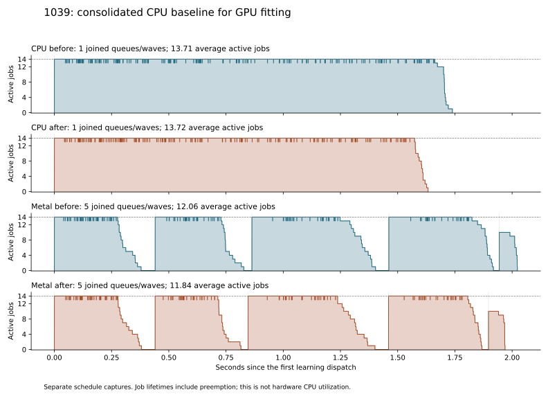

# Consolidated CPU baseline for GPU histogram fitting

2026-10-15, `feat/gpu-histogram-fitting`.

This baseline combines the continuous fitting scheduler and prior work
reduction with the committed `feat/modular` optimizations through `9d8a011`.
The merge is `3aca01c`. It supplies the reference implementation for the
[GPU operation/storage contract](gpu-histogram-fitting.md); tree fitting still
runs on CPU in both measured backend routes.

**The combined changes pass qualification and reduce complete-call time by
17.3% on both routes.** The sum of per-image medians falls from 10.089 to
8.348 seconds on CPU and from 10.617 to 8.777 seconds with Metal. All 60 calls
retain exact compressed bytes and independently decoded samples. The largest
measured improvement is in stream modeling/emission; training is now 65.6%
of CPU elapsed time and 70.3% of Metal elapsed time.

## Integration

The control already contains continuous local fitting queues, bounded feature
cohorts, fused occupancy/histogram scans and inherited constant-property masks
(`51dbbe0`, with qualification documentation in `aee5bc4`). The new merge adds:

- Shared/global tree property parallelism (`a9884e0`). Local fits keep one
  property participant and use their existing outer worker queue.
- Reusable bounded ANS histogram-search allocations (`2f9c4de`).
- Reuse of training-row hash positions between lookup and insertion
  (`5e3e4d7`).

Production source files merged without textual conflicts. Four test/tooling
files needed reconciliation: parallel learning, hybrid launch-failure checks,
the profiling reader and its README. Tests now distinguish local queue records
from shared-tree property-team records. Memory-pressure and partial-launch
checks retain both execution paths; local fits must not create nested teams.

The profiling reader accepts schemas 1–3 and the parallel per-job fitting
envelope. Shared-tree property timers overlap within a fit, so their sum cannot
be checked against or subtracted from elapsed fit time. Local photo diagnostics
continue to use one property participant per fit; their phase intervals can be
summed as work across fits, not as caller elapsed time.

The merge preserves explicit admission, reduced-concurrency retries before
execution, drained partial launches and failure-atomic publication. No codec
policy or default backend is changed. Other worktrees' uncommitted experiments
are outside this snapshot.

## Correctness checks

All 22 focused Release tests passed: worker orchestration; histogram learning
and preparation; parallel learning, entropy, selection and prepared
tokenization; reference, hybrid, hybrid palette and public Metal workflows;
public Modular API; entropy/storage, ANS selection/fault/search/bit-emission
checks; context maps; and prepared-stream checks.

The initial pass exposed an obsolete local-trace expectation in a shared-tree
memory-pressure test and four test executables that had not yet been built.
The assertion was corrected, the missing executables built, and all five
affected tests passed on rerun. The 17 unchanged passing tests retain their
original evidence. Initial and follow-up logs are both archived.

Focused CPU ThreadSanitizer checks passed for worker orchestration, the native
fitter, learning preparation, parallel entropy, entropy storage and the
42-case ANS search golden comparison. The learning run uses
`--preparation-only`; this is not a complete encoder or Metal sanitizer claim.
The ANS wrapper was rerun with its documented `--binary` option after an
initial command-line error that did not execute its probe.

The updated readers accepted 21 detailed historical/current profiles across
schemas 1–3. The new contract's allocation-free planners and validators also
pass Release and CPU-only C++23 AddressSanitizer/UBSan checks. Their source and
binary hashes and test logs are included under `validation/contract`.

## Measurement method

The matched control is the frozen `after` executable from
`build/fitting-work-reduction-integration-20261015/qualification`, SHA-256
`c6290d6155cff5f25d018e7004694a8637b4f12a81ff563a9991664801daf1dd`.
Its timing is measured again in this session. The candidate is the merged CPU
implementation with the unconnected GPU contract compiled into the library.
This comparison measures the combined incremental changes; it is not an
ablation assigning each speed difference to one incoming commit.

The corpus is 1029/1039/1049, each 4000×3000 RGB8. Settings are public learned
policy, Best predictors, estimated direct ANS and a 14-participant domain.
The device is Apple M4 Pro, 14 CPU cores, 48 GiB RAM, on AC power. Release uses
Apple Clang 21 with `-O3 -g -DNDEBUG`, Metal enabled, CUDA disabled and pinned
libjxl `e8ff0976` for independent decoding.

The profiler's `cpu` route explicitly selects CPU; `auto` explicitly selects
Metal with automatic feature-producer routing. Public automatic backend
selection remains CPU. Metal already accelerates eligible feature preparation
and token work, but the fitter in this capture is the CPU implementation.

Each input/binary/backend condition has one discarded fresh-process call,
three measured calls in rotating before/after order and one separate `fit-on`
diagnostic. Timed medians keep detailed fitting probes disabled. The timer
covers the complete public encoder call, including admission, selection,
training, GPU handoffs, tokens, entropy, cleanup and output publication.
File I/O, backend setup, diagnostic backing allocation and decoding are outside
that interval.

The runner checks AC power, competing GJXL/compiler work, frozen source/binary
and dependency hashes, exact historical compressed bytes and independent
decoding. All observations are retained. This is an active-desktop experiment:
Spotlight indexing is present in boundary snapshots, and boundary checks do
not continuously monitor the machine. Small differences should be interpreted
with the measured ranges.

## Complete encoder results

Seconds are medians of three measured calls; parentheses give the entire
minimum–maximum range. The control already includes the previous scheduler
and fitter work reduction.

| Image | Backend | Control | Consolidated | Less elapsed time |
| --- | --- | ---: | ---: | ---: |
| 1029 | CPU | 4.176 (4.120–4.177) | 3.466 (3.378–3.511) | 17.0% |
| 1039 | CPU | 3.051 (3.021–3.104) | 2.530 (2.527–2.558) | 17.1% |
| 1049 | CPU | 2.862 (2.809–2.885) | 2.353 (2.336–2.449) | 17.8% |
| 1029 | Metal | 4.404 (4.338–4.427) | 3.629 (3.569–3.746) | 17.6% |
| 1039 | Metal | 3.299 (3.274–3.398) | 2.744 (2.723–2.763) | 16.8% |
| 1049 | Metal | 2.914 (2.909–3.016) | 2.405 (2.404–2.456) | 17.5% |
| Sum of image medians | CPU | **10.089** | **8.348** | **17.3%** |
| Sum of image medians | Metal | **10.617** | **8.777** | **17.3%** |

Aggregate throughput improves by 1.209× on CPU and 1.210× with Metal. Metal
remains 5.1% slower than CPU in the new summed medians. Output sizes remain
10,507,251 / 7,138,537 / 7,015,756 bytes, or 24,661,544 bytes in total.

Caller-wall stage totals below sum independently computed per-image medians;
they need not add exactly to the median complete-call interval.

| Stage | CPU control → consolidated | Metal control → consolidated |
| --- | ---: | ---: |
| Selection | 1.212 → 1.231 | 1.207 → 1.231 |
| Training, including feature preparation | 5.513 → 5.476 | 6.298 → 6.174 |
| Token generation | 0.549 → 0.550 | 0.250 → 0.251 |
| Parallel stream modeling and emission | **2.695 → 1.015** | **2.777 → 1.035** |

Modeling/emission decreases 62.3% on CPU and 62.7% with Metal, consistent with
the incoming ANS allocation reuse. Training decreases only 0.7% and 2.0%; these
small differences do not establish an isolated hash-reuse speedup. The photos
use local trees, so they do not measure the benefit of the new shared-tree
property teams. Those paths are covered by the merged correctness checks and
the separate [shared-tree qualification](parallel-shared-tree-fitting.md).

## Remaining fitting work

All four detailed diagnostics per image have identical complete physical and
logical fitting signatures: row scans, node/split counts, constants, occupied
bins, candidate thresholds, entropy evaluations, swaps and canonical fit
records. Each image still performs 192 real fits in 197 canonical stream slots.
Local property parallelism is zero, with one property participant per fit.

| Image | CPU diagnostic fit work | Occupancy + histograms + candidate costs | Node time in nodes ≤1,024 rows |
| --- | ---: | ---: | ---: |
| 1029 | 28.708 s | 82.8% | 43.0% |
| 1039 | 18.225 s | 80.7% | 27.2% |
| 1049 | 16.804 s | 78.5% | 25.5% |

Fit work sums overlapping per-fit wall intervals and is **not** complete-call
elapsed time or process CPU time. Metal-route diagnostics show corresponding
target shares of 82.5% / 80.6% / 78.7% and small-node shares of
42.7% / 27.5% / 25.3%. These separate probe-enabled calls are excluded from
the timing medians. They identify candidate GPU work, not achievable speedup:
uploads, dispatches, waits, exact scoring, CPU selection/partitioning and
fallback still need implementation and measurement.

CPU retains one continuous queue; Metal retains 5 / 5 / 4 feature/fitting
cohorts. Average active jobs in the consolidated diagnostics are
13.77 / 13.72 / 13.75 on CPU and 12.04 / 11.84 / 12.59 with Metal.
These are job-lifetime occupancy, including preemption and excluding gaps
between joined cohorts, not hardware utilization.



The results support the contract's batch of ready nodes across independent
fits, followed by a measured CPU crossover for small work. Further broad CPU
profiling is not needed to identify the first GPU target. The next engineering
gate is the CPU evaluator adapter and resumable tree state, qualified with GPU
dispatch disabled before implementing Metal kernels.

## Resource and artifact checks

Before/after feature routing and scheduling counters match for every input
and backend. GPU feature samples remain 32,292,864 / 8,110,080 / 22,532,352;
GPU/CPU producer-batch counts remain 4/1, 1/22 and 3/5. Peak live features remain
8,110,080 samples and 162,217,728 bytes, within the 8 Mi-sample cohort cap.
No memory-driven concurrency reduction or early feature-cohort flush occurs.

CPU peak committed reservations decrease by 14.1 MiB per image; Metal committed
peaks are unchanged. Observed managed backing peaks increase by 4.4–8.1 MiB
across the six conditions. Committed reservations and actual live backing are
different accounting boundaries; these observations do not indicate an
admission failure or lost concurrency. Detailed maxima are in the structured
results.

The capture contains **12 discarded calls, 36 measured calls and 12 detailed
diagnostics**, completing in 4.60 minutes after the separate sample-row
experiment finished. Every call matches the historical output hash and decodes
exactly. AC power is recorded at every boundary; no competing GJXL/compiler
work was detected there. The final audit checks all 278 archived artifact
hashes, source hashes, routing and the full fitting signatures. No new Samply
capture or libjxl performance comparison was performed.

[Structured results](gpu-histogram-fitting-baseline-results.json) retain all
observations, ranges, raw diagnostic data, memory counters and environment
snapshots. Frozen executables, source/build evidence and validation logs are
under `build/gpu-histogram-fitting-baseline-20261015/qualification`.
The final audit is `build/gpu-histogram-fitting-baseline-20261015/final-audit.json`.

- Control executable SHA-256: `c6290d6155cff5f25d018e7004694a8637b4f12a81ff563a9991664801daf1dd`.
- Consolidated executable SHA-256: `4e191d5ffb22dc2e5416284b7c244589c9058d22971ae9d02663b119a33af2ed`.
- Consolidated source archive SHA-256: `748fad87d21ea0d9375a9e2a262ca3c9702a25f2524ba2c1050ba32ffbe9ddb4`.

## Reproduction

```sh
python3 tools/modular_reference_learning/run_fitting_schedule_qualification.py \
  --baseline-capture build/fitting-work-reduction-integration-20261015/qualification \
  --baseline-variant after --diagnostic-mode fit-on \
  --binary build/release/gjxl_modular_hybrid_profile \
  --input /path/to/photo-large-1029.pam \
  --input /path/to/photo-large-1039.pam \
  --input /path/to/photo-large-1049.pam \
  --out build/gpu-histogram-fitting-baseline-20261015/qualification \
  --validation-dir build/gpu-histogram-fitting-baseline-20261015/validation \
  --repeats 3

python3 tools/modular_reference_learning/report_fitting_schedule_qualification.py \
  build/gpu-histogram-fitting-baseline-20261015/qualification \
  --json docs/gpu-histogram-fitting-baseline-results.json \
  --plot docs/gpu-histogram-fitting-baseline-activity.svg \
  --plot-title '1039: consolidated CPU baseline for GPU fitting'
```
