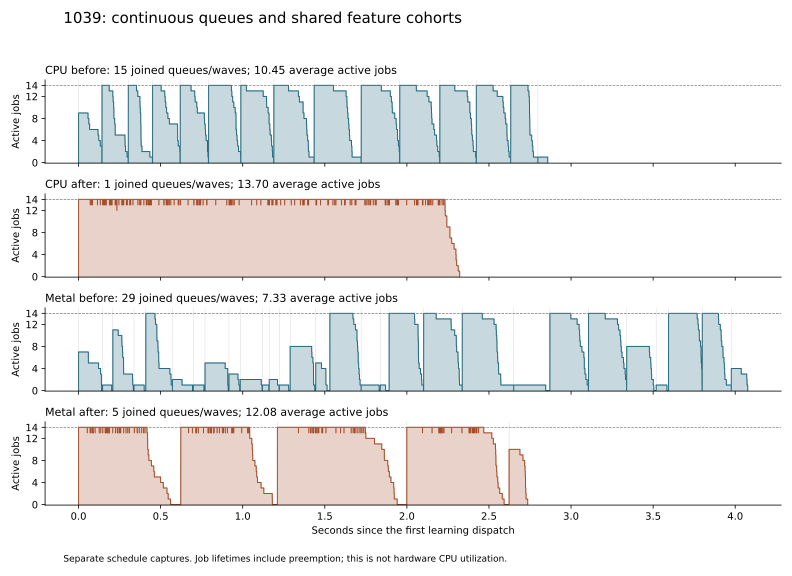

# Continuous local fitting and bounded feature cohorts

2026-10-15, `perf/parallel-tree-fitting`, based on `5ae11e4` plus the private
diagnostics from the [integrated profile](modular-parallel-workflow-profile.md).

The integrated profile found idle fitting capacity at two boundaries: every
participant-sized wave and every change in feature-producer eligibility. This
change preserves the learner and compression policy while making more ready
fits available to the existing CPU participants.

Matched qualification on 1029/1039/1049 reduced the sum of median encoder
times from **13.400 to 11.803 seconds on CPU** and **15.706 to 12.289 seconds
on Metal**: 11.9% and 21.8% less elapsed time, respectively. All 60 encodes
preserved the historical bytes and decoded exactly. Metal still takes 4.1%
longer than CPU in this aggregate; this change reduces that integration penalty.

The subsequent [work-reduction integration](modular-fitting-work-reduction-integration.md)
combines this scheduler with `ebfa2d5`. The measurements here remain the
scheduling-only comparison against `5ae11e4`.

## Scheduling and storage

Local jobs use a continuous ready queue. The caller initially admits at most
one complete job per requested participant. Each worker prepares samples,
fits and compacts a tree, closes its job reservation, then tries to admit the
next canonical job. A slow job no longer prevents other workers from advancing.
The retained tree's allocation stays charged after its reservation closes.

The admission mutex protects only queue advancement and reservation attempts;
sample preparation and fitting run outside it. Capacity is never awaited while
holding image or feature storage. A worker that cannot admit the next job exits;
other finishing workers may succeed after releasing their scratch. If all stop,
the caller joins them and retries the untouched suffix. When a conservative
whole-job envelope cannot fit, it releases scheduler metadata and uses the
existing serial per-stage admission. Completed jobs are never refitted.

Scheduler metadata now has one small job record per stream, while full fitter
diagnostic counters remain per worker. All metadata is managed and admitted.
Counters merge after the join, with fit records published in canonical stream
order. Workers still obey the image/domain CPU limits, participate through the
existing worker launcher, and join on partial launch or allocation failure.
An optional private launcher signal tells queue callbacks to stop taking jobs
when a partial launch fails, before joining the already running workers.
The prepared frame and complete output are published only on success.

For Metal, several feature owners can feed one local fitting cohort. Their
**combined population remains at most 8 Mi samples**. CPU/GPU eligibility still
separates producer batches; it no longer forces a fitting barrier. Feature
production completes before fitting, every fit joins before token generation,
and each feature owner remains alive until its own tokens finish. No feature
borrow escapes into the published frame.

At a capacity boundary, a cohort containing at least two participant groups
can end at the last complete group of actual coded streams. Excluded global
records and empty slots do not count toward that alignment. This avoids
one-fit spill tails; the final cohort is left intact. Alignment can change
automatic feature routing, so qualification records producer coverage as well
as complete-call time. If another feature owner cannot be admitted, an already
prepared local cohort is fitted/tokenized before retrying the untouched suffix.
Producer allocation/submission failures themselves propagate without retry.

Global/buffered learning still performs its one serial fit over the full scope.
The public policy, sampling, quantization, histogram arithmetic, split order,
predictor preferences, partitioning, trees and stream publication order are
unchanged. ANS allocation optimization is outside this change.

The private `learning.waves` field now counts joined ready-queue invocations;
one invocation can contain many more jobs than participants. Schedule probes
reserve canonical slots before launch and trim an unadmitted suffix only after
the join. Job lifetimes remain scheduling diagnostics, not hardware CPU usage.

## Qualification

Correctness checks cover exact tree/profile/byte parity, independent decoding,
Best/All predictors, CPU/domain ceilings, reduced memory capacity, absent and
nested participation, partial launches, shared-domain callers and feature-owner
lifetimes. A new mixed fixture alternates wide local palettes and ordinary
groups: four CPU and four GPU feature batches share one fitting cohort.
A separate two-run fixture exercises early cohort flushing at a 60 MiB
preparation budget, checks exact trees and complete bytes against CPU, and
decodes the result independently. Insufficient budgets return without publishing
a partial frame or leaking storage. The hybrid palette suite was rerun after
this memory-pressure coverage was added.

Nine focused Release suites passed: worker orchestration, parallel learning,
entropy, selection, prepared tokenization, both hybrid suites, public API and
public Metal workflow. ThreadSanitizer passed for worker orchestration and
`modular_parallel_learning --preparation-only`, including the cancellation
signal, resource limits, partial launches and shared-domain callers. The focused
sanitizer mode excludes entropy serialization and external decoding; those are
covered by the Release tests.

Performance compares the previously frozen executable with the updated public
encoder under matching conditions, rather than subtracting measurements taken
at different times. CPU isolates the queue change; Metal includes both queue
and feature-cohort changes.

## Complete encoder results

Seconds are medians of three measured fresh-process calls. Parentheses give
the full observed minimum–maximum range; no timed observation was removed.

| Image | Backend | Before | After | Less elapsed time |
| --- | --- | ---: | ---: | ---: |
| 1029 | CPU | 5.271 (5.256–5.466) | 4.780 (4.738–5.097) | 9.3% |
| 1039 | CPU | 4.203 (4.106–4.348) | 3.680 (3.513–3.896) | 12.4% |
| 1049 | CPU | 3.927 (3.897–3.988) | 3.343 (3.294–3.419) | 14.9% |
| 1029 | Metal | 6.058 (5.864–6.580) | 4.929 (4.896–5.364) | 18.6% |
| 1039 | Metal | 5.350 (5.278–5.354) | 3.897 (3.885–3.991) | 27.2% |
| 1049 | Metal | 4.297 (4.296–4.334) | 3.463 (3.431–3.524) | 19.4% |
| Sum of image medians | CPU | **13.400** | **11.803** | **11.9%** |
| Sum of image medians | Metal | **15.706** | **12.289** | **21.8%** |

These correspond to aggregate throughput improvements of 1.135× and 1.278×.
The measured outputs remain 10,507,251 / 7,138,537 / 7,015,756 bytes,
24,661,544 bytes total. There is no compression-rate change.

Stage totals sum independently computed per-image medians, so they need not
sum exactly to the median complete-call interval.

| Caller-wall stage | CPU before → after | Metal before → after |
| --- | ---: | ---: |
| Selection | 1.233 → 1.241 | 1.304 → 1.279 |
| Training, including feature preparation | **8.792 → 7.145** | **11.171 → 7.915** |
| Token generation | 0.554 → 0.572 | 0.256 → 0.253 |
| Parallel stream modeling and emission | 2.729 → 2.682 | 2.864 → 2.732 |

The learning interval falls 18.7% on CPU and 30.2% on Metal. On Metal,
learning alone totals 10.921 → 7.619 seconds, while feature preparation totals
0.252 → 0.295 seconds. The large improvement is in the joined preparation/fitting
interval. Training remains 60.5% of the new CPU total and 64.4% of the new
Metal total. The learner's histogram/scoring arithmetic is unchanged, and
batched GPU node evaluation remains a separate implementation effort.

## Worker activity

Every image still has 192 real fits in 197 canonical stream slots. The following
comes from one separate schedule capture per condition, excluded from timing
medians. Average activity is summed job lifetimes divided by summed joined
queue/wave intervals; gaps between cohorts are excluded from that denominator.
Jobs include preparation and fitting, including preemption. These values do
not measure physical CPU utilization.

| Image | CPU waves → queues | CPU average active jobs | Metal waves → cohorts | Metal average active jobs |
| --- | ---: | ---: | ---: | ---: |
| 1029 | 15 → 1 | 10.95 → 13.79 | 18 → 5 | 9.28 → 12.28 |
| 1039 | 15 → 1 | 10.45 → 13.70 | 29 → 5 | 7.33 → 12.08 |
| 1049 | 15 → 1 | 9.56 → 13.75 | 20 → 4 | 8.42 → 12.69 |



The CPU queue stays near 14 active jobs until its final tail. Metal retains
bounded cohort barriers, but changes in producer eligibility no longer leave
small sets of fits running alone. These traces support the scheduling
explanation; summed job lifetimes themselves also change with contention and
preemption, so occupancy ratios are not predicted speedups.

Common admission-bound planning now precedes the first queue probe. It remains
inside the learning and complete-call timers, but is outside the diagnostic
per-queue reservation/cleanup field. That field alone should not be compared
with the old per-wave overhead as a measure of total scheduling cost.

## Feature routing and memory

The automatic GPU threshold is unchanged. Aligning cohort ends can split a
homogeneous producer run below that threshold, changing which producer executes
it. GPU feature coverage decreases, especially on 1039:

| Image | GPU feature samples, millions, before → after | Share of transformed channel samples | GPU / CPU producer batches, before → after |
| --- | ---: | ---: | ---: |
| 1029 | 33.079 → 32.293 | 91.9% → 89.7% | 4 / 1 → 4 / 1 |
| 1039 | 20.517 → 8.110 | 65.5% → 25.9% | 3 / 17 → 1 / 22 |
| 1049 | 24.973 → 22.532 | 83.6% → 75.4% | 3 / 5 → 3 / 5 |

On 1039, feature preparation grows from 0.102 to 0.144 seconds, while learning
falls from 3.772 to 2.378 seconds. All features are still reused once by learning
and tokenization, and all Metal-route tokens are generated on the GPU. The
CPU feature fallback remains capped at four participants. The Metal result
qualifies the combined queue/cohort/alignment implementation; it does not
isolate each component's contribution or establish an optimal producer cutoff.

Peak live feature population is 8,110,080 samples on each photo, below the
8,388,608-sample cap. Peak retained feature storage is 162,217,728 bytes.
No full-photo call reduces learning/selection/entropy/tokenization concurrency
for memory, and no feature cohort needs the capacity fallback. Routing remains
identical across all repetitions of each before/after condition.

The maximum observed committed-memory peak is unchanged for every image/backend
pair. Across these pairs it ranges from 1,528.7 to 1,814.4 MiB; this includes
pending reservation capacity and is not physical resident memory. Managed
backing peaks change by at most 2.1 MiB. The new CPU backing peaks are
809.0 / 719.3 / 692.4 MiB, and Metal peaks are 739.1 / 658.0 / 635.6 MiB.
Full per-call memory counters are retained in the structured results.

## Measurement conditions and artifacts

Inputs are 4000×3000 RGB8 photographs on the Apple M4 Pro, 14 CPU cores,
48 GiB RAM, using AC power throughout the completed capture. Release uses
Apple Clang 21 with `-O3 -g -DNDEBUG`, Metal enabled and CUDA disabled.
The public C++ encoder uses learned policy, Best predictors, estimated direct
ANS and a 14-participant domain. Compared backends are explicit CPU and
explicit Metal. The profiler route name `auto` means Metal with automatic
**feature-producer** selection; public automatic backend selection still uses
CPU.

The complete-call interval includes admission, selection, preparation/fitting,
GPU handoffs, tokenization, entropy, frame teardown and output publication.
Input/output file I/O, backend initialization, diagnostic backing allocation
and independent decoding are excluded. The decoder is pinned libjxl
`e8ff09762481785938d8e4e01333ed3917571161`.

There are 12 discarded fresh-process calls, 36 measured calls and 12 separate
schedule diagnostics, with rotating before/after order. All **60 calls** passed
historical output hashes, independent exact decoding, equal learning-work
counters, CPU/memory limits and diagnostic coverage checks. Sources, binaries,
inputs and linked dependencies were hashed and checked for changes. Capture
took 5.95 minutes after the other experiments finished.

No competing GJXL/compiler work was detected at the capture boundaries. This
was still an active desktop with indexing/system activity, not an isolated
machine; ranges and all environment snapshots are preserved. The guard checks
boundaries rather than continuously monitoring every process. No new Samply
or libjxl performance comparison was run for this scheduling change.

[Structured results](modular-fitting-scheduling-results.json) include every
observation, scheduling records, hashes, environment snapshots and summary.
Raw outputs, both frozen executables, source archive/patch, build flags, test
logs and the completed manifest are in
`build/fitting-schedule-qualification-20261015-coordinated`.

- Before executable SHA-256: `5857776748d15da7b36d7d6df02eeee49e9c81b0d92be5593caddd00ecf5c343`.
- After executable SHA-256: `f7d80dfa9ea95ae5a646161554d548893a8d41cab308f5f1543935abfda709a3`.
- After source archive SHA-256: `46b2e566bcd4c0ea71c53ac7fd77d5a17e7272bb2eba01dd6ac329b092e7560e`.

### Interrupted attempts

The first attempt, `build/fitting-schedule-qualification-20261015`, was stopped
after 24 complete calls because a concurrent GJXL ANS-allocation benchmark and
compiler jobs overlapped the measurements. Its observations remain archived,
including a 10.425-second CPU outlier, but the entire attempt is excluded from
timing conclusions. The replacement repeats the complete before/after matrix;
it does not selectively replace individual slow calls.
An attempted restart, ending in `-repeat`, was also stopped after one discarded
call when that experiment launched another encode after an idle gap. Both
interruption notes are retained with the validation artifacts. The harness now
rejects known competing GJXL/compiler work in its boundary snapshots.

### Reproduction

```sh
python3 tools/modular_reference_learning/run_fitting_schedule_qualification.py \
  --baseline-capture build/parallel-workflow-profile-20261015 \
  --binary build/release/gjxl_modular_hybrid_profile \
  --input /path/to/photo-large-1029.pam \
  --input /path/to/photo-large-1039.pam \
  --input /path/to/photo-large-1049.pam \
  --out build/fitting-schedule-qualification-20261015-coordinated \
  --validation-dir build/fitting-schedule-validation-20261015 --repeats 3

python3 tools/modular_reference_learning/report_fitting_schedule_qualification.py \
  build/fitting-schedule-qualification-20261015-coordinated \
  --json docs/modular-fitting-scheduling-results.json \
  --plot docs/modular-fitting-scheduling-activity.svg
```
