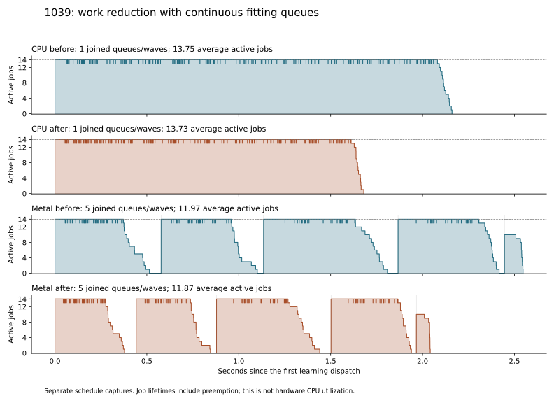

# Fitter work reduction with continuous scheduling

2026-10-15, `perf/parallel-tree-fitting`.

This integrates `ebfa2d508d6defbe6446b193716d345bffbf6410` from `feat/modular`
with the [continuous fitting scheduler and feature cohorts](modular-fitting-scheduling.md).
The incoming [work reduction](modular-fitter-work-reduction.md) fuses property
occupancy into the first predictor's histogram pass and inherits known constant
properties within each tree. Scheduling and feature-cohort policy are unchanged
by this integration.

The combined implementation was committed as `51dbbe0` after qualification.
Archived manifests retain the original pre-commit revision and source hashes.

**The changes compose successfully.** Compared with scheduling alone, the
combined implementation reduces the sum of median encoder times from
**11.707 to 10.357 seconds on CPU** and **12.374 to 10.918 seconds on Metal**,
an additional 11.5% and 11.8% reduction. All 60 encodes retain exact compressed
bytes and independently decoded samples. No production C++ conflict or
additional codec adaptation was required.

## Integration review

The branch fast-forwarded from `5ae11e4` to `ebfa2d5`. All 25 pre-existing
pending files were backed up under
`build/fitting-work-reduction-integration-20261015/preserved`. Only the tooling
README overlapped the incoming commit; its changes merged cleanly. All other
pending files retained their exact hashes immediately after the fast-forward.
The separate uncommitted shared-tree work in `gjxl-modular` was not imported.

The implementations meet at the existing per-fit call and storage planner:

- Each queued job owns its prepared samples, tree and fitter scratch. Constant
  masks live in that fit's pending nodes and are inherited by value, so they
  introduce no shared state between jobs or trees.
- The incoming node-size increase is included by the existing `sizeof(NodeInfo)`
  workspace bound. The continuous scheduler calls that planner for each whole-job
  reservation. Fitter-profile metadata is likewise sized with `sizeof`.
- The incoming profile merger includes both new counters. The scheduler keeps
  those counters per worker, merges after joining, and publishes per-fit records
  in canonical stream order.
- Feature-owner lifetimes, CPU grants, the 8 Mi-sample cohort limit and partial
  launch cancellation retain the previously qualified scheduling behavior.

No additional production C++ adaptation was needed. One diagnostic reader
assumed a serial `detail_wall.fitting` field; it now also accepts parallel
profiles' `detail_work.fitting`, whose per-job intervals overlap. The parallel
learning test now requires nonzero fused visits and constant-property skips
before comparing all counters against serial execution.

## Correctness and resource checks

All **11 focused Release CTests passed** in 70.50 seconds: worker orchestration,
histogram learning/preparation, parallel learning/entropy/selection/tokenization,
both hybrid suites, public API and public Metal workflow. They cover exact
trees and complete bytes, independent decoding, Best/All predictors, prefix/ANS,
CPU/domain limits, memory pressure, partial launches, allocation failures,
feature-owner lifetimes and failure-atomic publication. The 60 MiB cohort-flush
fixture continues to pass with the larger fitter-node bound.

Focused CPU-only ThreadSanitizer checks passed for worker orchestration and
`modular_parallel_learning --preparation-only`. The latter includes per-worker
profile aggregation and repeated independent fits. This is not a whole-encoder
or Metal sanitizer claim.

The updated reader validates all 24 historical parallel schema-1 profiles from
the integrated profiling study and all six schema-1/schema-2 diagnostics from
the work-reduction study. The latter retain equal logical fitting signatures
and reproduce the documented physical scan counts. Logs and check records are
archived under the integration capture's `validation` directory.

## Qualification method

The performance control is the frozen **scheduling-only** executable from
`build/fitting-schedule-qualification-20261015-coordinated/after`, SHA-256
`f7d80dfa9ea95ae5a646161554d548893a8d41cab308f5f1543935abfda709a3`.
The candidate combines that scheduler with `ebfa2d5`. This measures the
incremental effect of work reduction with scheduling already enabled. It is
not a four-way ablation and does not reuse earlier timing medians as controls.

The runner now supports selecting a frozen before/after executable from an
earlier capture, and a separate `fit-on` diagnostic mode. Repeated timing calls
keep detailed fitter probes disabled. Diagnostic pairs compare all logical
node/property/candidate counters, distributions and canonical fit shapes while
allowing the four scan/skip counters intentionally changed by work reduction.
Within the same implementation, CPU and Metal must match every work counter.

The completed matrix uses 1029/1039/1049, explicit CPU and Metal, a 14-participant
domain, learned policy, Best predictors and estimated direct ANS. Each condition
has one discarded fresh process and three measured fresh processes, in rotating
before/after order, followed by one separate detailed diagnostic per condition.
All complete outputs match the historical hashes and decode exactly with
pinned libjxl. Power and competing-work checks guard every process boundary.

The inputs are 4000×3000 RGB8, on the Apple M4 Pro with 14 CPU cores and 48 GiB
RAM. AC power was recorded at every boundary. Release uses Apple Clang 21,
`-O3 -g -DNDEBUG`, Metal enabled, CUDA disabled and pinned libjxl `e8ff0976`.
The profiler's `auto` route means explicit Metal with automatic feature-producer
selection; public automatic backend selection remains CPU.

Timing includes the complete public encoder call: admission, selection,
preparation/fitting, GPU handoffs, tokenization, entropy, teardown and output
publication. Input/output file I/O, backend setup, diagnostic backing allocation
and independent decoding are excluded. This remains an active-desktop study;
all observations and boundary snapshots are retained. No competing GJXL/compiler
work was detected at those boundaries, which do not continuously monitor every
process.

## Complete encoder results

Seconds are medians of three measured calls; parentheses contain the complete
minimum–maximum range. The control already includes continuous queues and
bounded feature cohorts. These are additional gains from work reduction.

| Image | Backend | Scheduling only | Scheduling + work reduction | Less elapsed time |
| --- | --- | ---: | ---: | ---: |
| 1029 | CPU | 4.762 (4.742–4.825) | 4.256 (4.217–4.298) | 10.6% |
| 1039 | CPU | 3.604 (3.597–3.626) | 3.162 (3.160–3.186) | 12.3% |
| 1049 | CPU | 3.341 (3.316–3.350) | 2.939 (2.918–2.961) | 12.0% |
| 1029 | Metal | 4.992 (4.948–5.046) | 4.475 (4.454–4.503) | 10.3% |
| 1039 | Metal | 3.932 (3.893–3.943) | 3.419 (3.305–3.430) | 13.1% |
| 1049 | Metal | 3.450 (3.437–3.490) | 3.024 (2.974–3.072) | 12.4% |
| Sum of image medians | CPU | **11.707** | **10.357** | **11.5%** |
| Sum of image medians | Metal | **12.374** | **10.918** | **11.8%** |

This corresponds to 1.130× CPU and 1.133× Metal aggregate throughput.
Metal remains 5.4% slower than CPU in the new summed medians. Outputs remain
10,507,251 / 7,138,537 / 7,015,756 bytes, 24,661,544 bytes total.

Caller-wall stage totals below sum independently computed per-image medians;
they need not add exactly to the median complete-call interval.

| Stage | CPU before → after | Metal before → after |
| --- | ---: | ---: |
| Selection | 1.258 → 1.263 | 1.264 → 1.270 |
| Training, including feature preparation | **7.073 → 5.744** | **7.934 → 6.423** |
| Token generation | 0.566 → 0.550 | 0.254 → 0.257 |
| Parallel stream modeling and emission | 2.719 → 2.703 | 2.814 → 2.855 |

The learning interval decreases 18.8% on CPU and 19.9% on Metal. Metal learning
alone totals 7.637 → 6.115 seconds; its separate feature preparation is
0.299 → 0.308 seconds. Training remains the largest joined stage, accounting
for 55.5% of the new CPU total and 58.8% of the new Metal total. The improvement
is concentrated in training, while selection, tokens and entropy remain similar.

## Work reduction and scheduling coexist

The 12 detailed diagnostic calls verify identical node/split counts, logical
properties/constants, occupied-bin distributions, candidate thresholds, entropy
evaluations, row swaps and canonical per-fit shapes. CPU and Metal also have
identical physical work counters within each implementation. Their counts
reproduce the independently qualified work-reduction commit exactly:

| Image | Property/histogram row passes, billions, before → after | Reduction | Known constant properties skipped |
| --- | ---: | ---: | ---: |
| 1029 | 13.164 → 7.658 | 41.8% | 562,149 |
| 1039 | 10.637 → 6.147 | 42.2% | 295,704 |
| 1049 | 10.057 → 5.796 | 42.4% | 250,757 |

These physical passes are `property_row_visits + joint_histogram_row_visits -
fused_property_row_visits`; the historical control has zero fused visits.
They measure this subset of fitter work, not all computation in learning or
encoding. Fused occupancy now belongs to the joint-histogram phase, so comparing
occupancy time alone would misattribute work moved between phase labels.

Each image retains 192 real fits in 197 canonical stream slots. CPU uses one
continuous queue; Metal uses 5 / 5 / 4 fitting cohorts. The diagnostic traces
show similarly busy workers completing shorter fits:

| Image | CPU average active jobs, before → after | Metal average active jobs, before → after |
| --- | ---: | ---: |
| 1029 | 13.69 → 13.78 | 12.08 → 12.09 |
| 1039 | 13.75 → 13.73 | 11.97 → 11.87 |
| 1049 | 13.71 → 13.83 | 12.63 → 12.59 |



These captures enable both fitting and scheduling probes and are excluded from
the timing medians. Average activity divides summed job lifetimes by summed
joined intervals, excluding inter-cohort gaps. Lifetimes include preemption;
they are not hardware CPU utilization or a speedup prediction. Per-fit phase
timers likewise overlap across workers.

## Resource and artifact checks

Producer routing and all learning scheduling counters match before/after.
GPU feature samples remain 32,292,864 / 8,110,080 / 22,532,352, with GPU/CPU
producer-batch counts 4/1, 1/22 and 3/5. Every Metal feature is reused by learning
and tokenization. Peak live feature population remains 8,110,080 samples and
162,217,728 bytes, below the same 8 Mi-sample cap. There are no memory-driven
concurrency reductions or early feature-cohort flushes in the photo capture.

Maximum observed committed-memory peaks are identical for every image/backend
pair, ranging from 1,528.7 to 1,814.4 MiB. This includes pending reservations,
not just backing allocations. Managed backing peaks differ by at most 2.7 MiB;
the larger node bound causes no admission failure or loss of concurrency here.

The completed capture contains **12 discarded calls, 36 measured calls and
12 detailed diagnostics**. Every call matches the historical compressed hash
and independently decodes exactly. The manifest reports `passed` after checking
all sources, binaries, inputs, dependencies, work counters and diagnostic
coverage. Capture took 5.23 minutes, after the separate sample-hash benchmark
finished. No new Samply or libjxl performance run was needed for this comparison.

[Structured results](modular-fitting-work-reduction-integration-results.json)
retain all observations, raw diagnostic data, ranges, memory counters, hashes
and environment snapshots. Raw artifacts and frozen source/build/test evidence
are under `build/fitting-work-reduction-integration-20261015/qualification`.

- Scheduling-only executable SHA-256: `f7d80dfa9ea95ae5a646161554d548893a8d41cab308f5f1543935abfda709a3`.
- Combined executable SHA-256: `c6290d6155cff5f25d018e7004694a8637b4f12a81ff563a9991664801daf1dd`.
- Combined source archive SHA-256: `1cd66d793683ab4f80b5802b04ceac5d16ae4b369688f25f349b64580a627fb3`.

## Reproduction

```sh
python3 tools/modular_reference_learning/run_fitting_schedule_qualification.py \
  --baseline-capture build/fitting-schedule-qualification-20261015-coordinated \
  --baseline-variant after --diagnostic-mode fit-on \
  --binary build/release/gjxl_modular_hybrid_profile \
  --input /path/to/photo-large-1029.pam \
  --input /path/to/photo-large-1039.pam \
  --input /path/to/photo-large-1049.pam \
  --out build/fitting-work-reduction-integration-20261015/qualification \
  --validation-dir build/fitting-work-reduction-integration-20261015/validation \
  --repeats 3

python3 tools/modular_reference_learning/report_fitting_schedule_qualification.py \
  build/fitting-work-reduction-integration-20261015/qualification \
  --json docs/modular-fitting-work-reduction-integration-results.json \
  --plot docs/modular-fitting-work-reduction-integration-activity.svg \
  --plot-title '1039: work reduction with continuous fitting queues'
```
