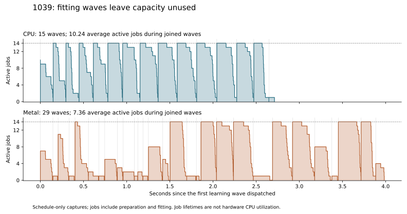

# Integrated parallel Modular profiling

2026-10-15. `perf/parallel-tree-fitting` was fast-forwarded to `feat/modular`
at `a7ceac35f4aa0e9410ab2fbc3e535f99c058a984`. This study profiles that integrated
implementation with opt-in diagnostics; no selection, fitting, tokenization or
entropy policy or scheduling algorithm is changed.

During capture, `feat/modular` advanced to `5ae11e4` with allocation-test, CI and
documentation changes. This worktree was subsequently fast-forwarded there as
well. The encoder/profiler sources are unchanged between those revisions;
regenerating the build required no profiler compilation or linking and retained
the identical executable hash. The measurements below remain identified by
their frozen `a7ceac3` source snapshot.

The later [fitting scheduling implementation and qualification](modular-fitting-scheduling.md)
address the scheduling findings below; this report preserves the original
wave-scheduler measurements.

**Preparation/fitting remains the main elapsed-time target, but the profile
also identifies two concrete CPU scheduling/allocation opportunities.** The
Metal feature-batch boundaries fragment the CPU fits into small waves, and
parallel ANS modeling repeatedly enters the shared managed-memory mutex.
Batched GPU node evaluation remains the largest compute target; improve or
account for these two effects before judging its end-to-end benefit.

## Complete encoder and remaining stages

Seconds: median of three `fit-off` calls, with every observation retained.
The ranges are material, especially for 1049. These are timings of the current
capture, not matched speedups over earlier revisions or power conditions.

| Image | Public CPU | CPU range | Public Metal | Metal range |
| --- | ---: | ---: | ---: | ---: |
| 1029 | 5.341 | 5.249–5.379 | 5.858 | 5.851–6.134 |
| 1039 | 4.087 | 4.071–4.215 | 5.183 | 5.110–6.115 |
| 1049 | 4.082 | 3.962–4.567 | 5.580 | 4.248–6.651 |
| Sum of image medians | **13.509** | | **16.621** | |

Stage totals below sum per-image medians. Independently computed medians need
not sum exactly to the complete encoder interval.

| Stage | CPU seconds | CPU share | Metal seconds | Metal share |
| --- | ---: | ---: | ---: | ---: |
| Selection | 1.294 | 9.6% | 1.237 | 7.4% |
| Training, including feature preparation | 8.842 | **65.5%** | 12.089 | **72.7%** |
| Token generation | 0.562 | 4.2% | 0.271 | 1.6% |
| Parallel stream modeling + emission | 2.707 | 20.0% | 2.921 | 17.6% |

Metal feature preparation accounts for only 0.264 seconds summed across the
image medians, nested in training. Its GPU/CPU feature batches are respectively
4/1, 3/17 and 3/5; Metal generates all tokens in 5, 20 and 8 batches. Learning
reuses all completed features and computes no replacements. Selection,
histogram sample preparation, fitting and entropy modeling remain CPU work.
The CPU route generates its sample tokens on CPU using the parallel tokenizer.

## Learning waves explain an integration penalty

Each image has 192 real fits in 197 canonical stream slots. On the CPU path,
all slots can enter one learning scheduler. Metal prepares a bounded feature
batch, finishes its fits, generates its tokens, then advances to the next batch.
Both paths also wait for every job in a wave before starting the next wave.

The following uses the `schedule` observation with median learning time for
each image/backend. It is separate from the `fit-off` timing table.

| Image | CPU waves | Metal waves | CPU average active jobs | Metal average active jobs | CPU/Metal waves with fewer than 14 participants |
| --- | ---: | ---: | ---: | ---: | ---: |
| 1029 | 15 | 18 | 10.91 | 9.37 | 1 / 5 |
| 1039 | 15 | 29 | 10.24 | 7.36 | 1 / 20 |
| 1049 | 15 | 20 | 10.10 | 8.75 | 1 / 8 |

For 1029, three Metal feature batches each yield **14 + 14 + 14 + 1** jobs;
the final fit waits for its predecessors and then runs alone. For 1039,
`HybridLearning::Prepare` splits on changes in GPU feature eligibility as well
as batch limits. The resulting 20 feature batches include many small CPU
fallback batches. This preserves feature ownership, but restricts the ready
work available to the CPU fitter.

On 1039, the representative CPU and Metal traces contain almost equal summed
job lifetimes (27.685 and 28.014 seconds), yet their joined waves take 2.703 and
3.806 seconds. Average job concurrency falls from 10.24 to 7.36. This supports
scheduling/batch fragmentation as a cause of the longer training interval;
it is not evidence that the Metal feature kernel itself consumes that extra
second. Background preemption still contributes to individual job lifetimes.



Per-wave admission and post-join cleanup sum to about 0.010–0.011 seconds per
image. More significantly, the last-finishing worker's preparation and fitting
account for nearly all joined-wave time. In representative `fit-on` traces:

| Image/backend | Joined waves | Preparation on last-finishing workers | Fitting on last-finishing workers |
| --- | ---: | ---: | ---: |
| 1029 CPU | 3.542 | 0.456 | 3.084 |
| 1029 Metal | 4.091 | 0.552 | 3.530 |
| 1039 CPU | 2.670 | 0.486 | 2.182 |
| 1039 Metal | 3.702 | 0.558 | 3.142 |
| 1049 CPU | 2.847 | 0.619 | 2.226 |
| 1049 Metal | 2.965 | 0.512 | 2.450 |

This selects the observed last-finishing worker in each wave and follows all
of that worker's jobs. It is a valid disjoint observed chain, but changing work
costs can change which worker finishes last. It must not be used as a promised
speedup. Preparation/fitting on the other workers overlaps this chain.

## What remains inside fitting

The detailed probes agree with the earlier serial study. Percentages below
are shares of **summed fitter wall intervals** across the three measured Metal
calls, not percentages of complete elapsed time. CPU proportions are similar.

| Fitter phase | 1029 | 1039 | 1049 |
| --- | ---: | ---: | ---: |
| Property occupancy + cost-array initialization | 17.1% | 21.0% | 21.0% |
| Joint property/residual histograms | 38.5% | 46.4% | 46.3% |
| Prefix updates + entropy/predictor evaluation | 31.1% | 18.3% | 16.9% |
| Sample partitioning | 7.4% | 8.6% | 10.0% |
| Remaining phases and envelope residual | 5.9% | 5.7% | 5.8% |

Occupancy, joint histograms and candidate evaluation together account for
**84–87%** of fitting work. Allocation/setup is at most about 0.1%. Small nodes
with at most 1,024 distinct rows still account for 20–34%; nodes above 65,536
rows account for only 16–19%. A GPU implementation needs batches across trees
and a measured small-node cutoff; accelerating only roots misses most work.

All-thread Samply independently attributes 53–63% of encoder sampled CPU to
the native fitter. On Metal, the two `CollectExtraBitsIncrease` variants account
for about 35/41/41% of fitter leaf CPU on 1029/1039/1049. `EstimateBits` plus
`FastLog2` account for about 24/14/12%. These percentages have a different
denominator from wall-stage shares. The estimator already uses ARM NEON; this
is not evidence of a missing scalar-to-SIMD conversion.

## ANS allocation synchronization is a second opportunity

The new parallel stream encoder has an allocation-related hotspot. Samply
finds mutex wait/drop routines beneath `ResourceReservation::PrepareAllocation`
and `ResourceAllocation::Reset`, frequently reached through
`BuildBestAnsHistogram`, configuration candidate copies and destruction.
The source confirms that allocation preparation, commit and release update
the shared budget under its mutex.

| Image | CPU: managed-allocation mutex samples / stream-encoding CPU | Metal: same ratio |
| --- | ---: | ---: |
| 1029 | 60.4% | 59.3% |
| 1039 | 64.3% | 63.6% |
| 1049 | 62.6% | 64.2% |

These are sampled CPU deltas attributed to stacks with an explicit managed
allocation/reservation ancestor, not total blocked wall time. They represent
about 13–18% of total encoder sampled CPU. Assigning deltas to preceding stacks
instead gives 58.5–63.9% of stream-encoding CPU, preserving the conclusion.
Other mutex samples are retained separately; the table uses the narrower,
identifiable managed-allocation subset.

Repeated small backing allocations across parallel model jobs now warrant a
scratch-reuse experiment. This profile does not establish that removing locks
would recover the sampled duration, and resource accounting must remain exact.

## Recommended next steps

1. **Improve fitting scheduling and feature-batch formation first.** Keep a
   bounded set of admitted worker slots busy across ready fits, instead of
   imposing a barrier after every group of 14. Avoid one-fit spill waves where
   a feature batch can end at a better boundary. Separately investigate the
   eligibility-driven tiny batches: coalesce CPU-feature work or use bounded
   lookahead with explicit feature-owner lifetimes. Measure those changes
   separately; retain exact trees, bytes and domain limits.
2. **Reduce ANS allocation traffic.** Reuse per-worker histogram/configuration
   scratch, or use a bounded, pre-admitted backing arena where appropriate.
   Preserve retained candidate lifetimes, failure atomicity and managed memory
   accounting. Confirm with complete-call timing and the same mutex attribution.
3. **Prototype batched GPU node evaluation using real workload shapes.** Target
   occupancy, joint histograms and candidate scoring together, retaining CPU
   split decisions/partitioning initially. Include dispatch, synchronization,
   staging, small-node fallback and numerical parity. The fitter remains the
   largest compute target; the first two changes provide a stronger baseline
   for deciding whether the full GPU integration is worthwhile.

## Validation and instrumentation effects

All **78 complete encodes** matched historical compressed hashes and decoded
exactly with pinned libjxl `e8ff0976`: 18 discarded runs, 54 measured runs and
six Samply diagnostics. The three files remain 10,507,251 / 7,138,537 /
7,015,756 bytes. All power boundary snapshots report AC, no workflow reports
memory-driven concurrency reduction, and fitting work signatures match across
CPU, Metal and repetitions.

Eight focused Release suites passed: parallel learning, entropy, selection,
prepared tokenization, public API, both hybrid suites and the public Metal
workflow. The learning test verifies trace bounds/order, disjoint job records,
tree/profile/byte parity and resource/failure behavior. It was rerun after the
trace's final record changes. The focused CPU-only ThreadSanitizer preparation
test also passed with no reported races; it excludes entropy serialization and
the external decoder. The Release suites provide decoding/Metal coverage.

Compared with `fit-off`, median complete-time changes for schedule-only traces
range from −5.8% to +3.1%; detailed fitter probes range from −22.4% to +5.9%.
The negative values, particularly on noisy 1049, demonstrate why these deltas
cannot isolate a small probe overhead in this desktop capture. They are not
speedups. Timing conclusions use `fit-off`; detailed phase/occupancy results
remain separately labeled. The CPU 1049 detailed-probe outlier of 7.275 seconds
and Metal `fit-off` outlier of 6.651 seconds are both retained.

Each Samply capture contains 362–385 thread records over the process lifetime,
not that many simultaneous workers. Resolved fitter leaf coverage is at least
99.95%; source/inline coverage of native fitter leaf CPU is 97.7–98.3%.

[Structured results](modular-parallel-workflow-profile-results.json) contain
all observation summaries, full-result hashes, phase/node distributions,
representative wave details, sampled function tables and provenance. Full raw
records and profiles are retained in `build/parallel-workflow-profile-20261015`.
Analysis scripts were refined after capture; their hashes are recorded along
with the frozen capture manifest. The archive preserves the measured C++
sources; later scheduling changes are qualified separately.

- Frozen executable SHA-256: `5857776748d15da7b36d7d6df02eeee49e9c81b0d92be5593caddd00ecf5c343`.
- Frozen source archive SHA-256: `182820c5d0b65a1592332f5ccf8f1cb009c3e8968d5c49f7103faa8f652e989b`.

## Measurement boundaries

The public C++ `EncodeModularImage` API is called with the learned policy,
estimated direct ANS, Best predictors and a 14-participant execution domain.
The compared backends are explicit CPU and explicit Metal. Metal uses automatic
feature-producer selection and GPU tokens. Public automatic backend selection
still selects CPU; the profiler's historical route name `auto` means explicit
Metal with automatic **feature** selection.

Inputs are the original 4000×3000 RGB8 photographs 1029, 1039 and 1049. Release
uses Apple Clang, `-O3 -g -DNDEBUG`, on the M4 Pro with 14 CPU cores and 48 GiB.
The encoder interval includes admission, selection, preparation/fitting, GPU
handoffs, tokenization, entropy, frame teardown and public output publication.
Input loading, reference sample unpacking, backend initialization, diagnostic
backing allocation, independent decoding and file I/O are outside it.

Each image/backend has three instrumentation modes: the existing top-level
timers alone (`fit-off`), those timers plus fitting-wave/job intervals
(`schedule`), and both plus detailed native-fitter probes (`fit-on`). The same
frozen executable runs every mode. Each condition has one discarded fresh
process followed by three measured fresh processes, in rotating order. This
is not an in-process warmed-loop benchmark. All-thread 1 kHz Samply captures
are separate diagnostic runs with detailed probes disabled, excluded from
timing medians.

These are active-desktop observations. Before/after snapshots retain power,
thermal status, load and the busiest processes. Background indexing and other
system services produced visible variation; no observation is silently removed.
No new libjxl timing comparison or hardware memory-bandwidth measurement is made.

## How to interpret the diagnostics

The top-level stages are caller-wall intervals. Parallel stream encoding mixes
model construction and payload emission across workers, so its joined interval
must be reported together rather than splitting overlapping work into additive
wall stages. Feature preparation is within training; GPU token generation is
within the token stage.

Preparation and fitter phase durations are sums of per-job wall intervals.
They overlap and are **not** extra encoder stages or measured CPU time. The
learning-wave trace records admission start, dispatch, join, cleanup and each
job's lifetime and preparation/fitting sub-intervals. Canonical empty slots
remain represented separately from actual fits.

Average active jobs is the integral of job lifetimes divided by joined wave
time. A job can be preempted while alive: this is scheduling occupancy, **not**
hardware CPU utilization. Unused slot-time combines underfilled waves, launch
stagger, uneven job completion and waits; it is not a directly achievable
speedup. The trace does not identify which jobs ran on performance versus
efficiency cores.

Samply attribution uses per-thread CPU deltas across all captured threads.
Current- and previous-stack assignments are both retained. Encoder/fitter
samples are distinguished from input, independent decoding and service-thread
work. Flat function rows are disjoint; inclusive function rows overlap. Native
inline locations are resolved against the matching frozen binary and dSYM.

## Reproduction

The runner archives build/tool sources, a source patch, executable and dSYM,
build flags, linked-library/input/output hashes, raw per-call JSON and Samply
captures. It checks AC power at both boundaries of each call and exact decoding
and historical compressed-file hashes for every complete output. Duplicate
verified output files use APFS clones while retaining their individual paths.

```sh
python3 tools/modular_reference_learning/run_parallel_profile.py \
  --binary build/release/gjxl_modular_hybrid_profile \
  --input /path/to/photo-large-1029.pam \
  --input /path/to/photo-large-1039.pam \
  --input /path/to/photo-large-1049.pam \
  --out build/parallel-workflow-profile-20261015 --repeats 3

python3 tools/modular_reference_learning/analyze_parallel_samply.py \
  build/parallel-workflow-profile-20261015/photo-large-1029-auto-fit-off-1-samply.json.gz \
  --binary build/parallel-workflow-profile-20261015/hybrid_profile \
  --output build/parallel-workflow-profile-20261015/photo-large-1029-auto-fit-off-1-samply-analysis.json

# Analyze each of the six Samply captures, then combine the evidence:
python3 tools/modular_reference_learning/report_parallel_profile.py \
  build/parallel-workflow-profile-20261015 \
  --json docs/modular-parallel-workflow-profile-results.json \
  --plot docs/modular-parallel-workflow-occupancy.svg
```

The private driver retains its earlier schemas and controls. Supplying the
trailing `public` argument selects schema 6 and requires default policy plus
matching per-stage limits; the public API itself chooses its normal policies.
The wave trace owns no codec allocations, performs no hot-loop atomics, and
writes disjoint preallocated job slots until all workers join.
